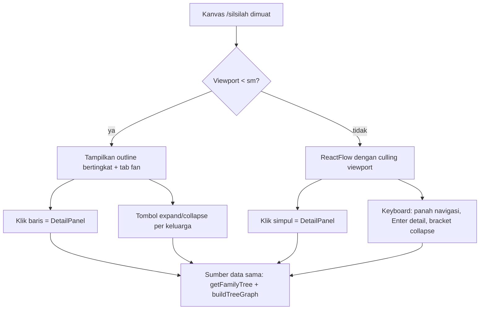

# 02 — Evaluasi Teknologi Render Pohon Silsilah (Mobile)

Kartu 2/4 dari riset tampilan silsilah Wirjodihardjo. Cakupan: perbandingan teknologi
render untuk `/silsilah` pada skala 250–300 orang. Tidak membahas data, CMS, atau
deployment — itu kartu lain.

## 1. Fakta terverifikasi dari repo (bukan asumsi)

Semua angka di bawah dibaca langsung dari repo `wirjodihardjo` HEAD `7a36c68`
di host orca, bukan dari dokumentasi.

| Item | Nilai terukur |
|---|---|
| `src/components/silsilah/treeLayout.ts` | 706 baris (543 kode, 109 komentar, 65 kosong) |
| `src/components/silsilah/treeLayout.test.ts` | 725 baris, 23 blok `test()`, 66 panggilan `assert.*` |
| Runner tes | `node:test` + `node:assert/strict`; **tidak ada script `test` di `package.json`** |
| `FamilyTreeCanvas.tsx` | 133 baris, satu `<ReactFlow>`, `fitView`, `minZoom={0.1}`, `maxZoom={1.6}` |
| Ukuran kartu orang | `NODE_W = 260`, `NODE_H = 130`, `COUPLE_SPACING = 300`, `GAP_X = 60`, `GAP_Y = 80`, `NODE_MIN_GAP = 16` |
| `PersonNode.tsx` | 248 baris, sudah dibungkus `memo()` (baris 248) |
| `onlyRenderVisibleElements` | **tidak dipakai** di seluruh `src/` |
| Viewport HP kelas menengah | 375–393 px CSS |

Dua temuan yang langsung menjelaskan keluhan mobile:

1. **Kartu 260 px di viewport 375 px.** Satu kartu orang hampir memenuhi lebar layar.
   `fitView` memaksa seluruh pohon masuk ke layar, jadi pada 250–300 node zoom efektif
   jatuh ke bawah `minZoom=0.1` dan teks nama menjadi tidak terbaca. Ini masalah
   ukuran kartu dan strategi navigasi, bukan masalah jumlah node.
2. **MiniMap sudah disembunyikan di mobile** (`className="!hidden … sm:!block"`),
   sementara interaksi utama — klik ganda untuk melipat cabang — hanya terpetakan ke
   event mouse. Tidak ada padanan keyboard.

Selain itu, `src/app/api/family/graph/route.ts` (111 baris) berisi implementasi
layout **kedua** yang berbeda: rekursi sederhana dengan `yStep = 130`,
`xSpread = 220`, dan query Prisma per simpul (pola N+1). Kanvas tidak memakainya —
`FamilyTreeCanvas` memakai `getFamilyTree()` dari `src/lib/data.ts`. Ini kode mati
yang sebaiknya dihapus pada kesempatan apa pun, agar tidak ada dua sumber kebenaran
geometri.

## 2. Yang harus dipertahankan dari `treeLayout.ts`

`buildTreeGraph` bukan sekadar "susun pohon". Ia menangani hal yang membuatnya mahal
untuk ditulis ulang:

- **Banyak pernikahan per orang.** Setiap orang boleh punya beberapa pasangan; kartu
  primary di kiri, pasangan berjajar ke kanan menurut `orderIndex`, dan anak dari
  pernikahan tertentu digantung di bawah segmen pernikahan itu.
- **Relasi anak bertingkat:** kandung (garis solid), tiri (`6 4` dash), angkat
  (`1 5` dot) — dibedakan lewat `parentRole`, `isStep`, `isAdopted`.
- **Union-find antar komponen.** Orang tanpa orang tua tidak dijadikan akar terpisah;
  komponen yang terhubung lewat relasi disatukan, lalu tiap komponen memilih akar
  (prioritas: bukan menikah-masuk, `generationLevel` terkecil, lalu id) dan dikemas
  berurutan.
- **Pemaketan berbasis kontur.** `leftContour`/`rightContour` per kedalaman supaya
  saudara daun dipakai mengikuti bentuk baris, bukan setelah subtree lebar.
- **Jaminan anti-tumpuk** `NODE_MIN_GAP = 16` untuk kartu pada baris yang sama.
- **Determinisme** dan penyembunyian orang tanpa relasi (kecuali `showDisconnected`).

Ini 543 baris kode yang menjawab domain, bukan perpustakaan. Setiap opsi di bawah 3
dinilai terutama dari satu pertanyaan: apa yang terjadi pada 543 baris ini dan pada
725 baris tesnya.

## 3. Perbandingan lima opsi

Kolom "Dampak ke `treeLayout.ts` + tes" adalah jawaban langsung atas pertanyaan itu.

| # | Opsi | Dampak ke `treeLayout.ts` (543 baris) + tes (725 baris, 23 tes) | Performa 250–300 node di HP menengah | Aksesibilitas (screen reader + keyboard) | Risiko regresi | Dukungan Next 16 / React 19 | Biaya adaptasi |
|---|---|---|---|---|---|---|---|
| a | **React Flow sekarang, dioptimalkan** | **Dipertahankan utuh.** Nol perubahan geometri → 23 tes tetap hijau. Tambah 5–10 tes baru untuk perilaku viewport (culling, zoom awal) | Cukup. React Flow 12.11.2 membawa sejumlah perbaikan performa (drag instance hanya untuk node draggable, MiniMap berhenti render tiap update store, transform pan/zoom diterapkan imperatif) [12]; namun issue `onlyRenderVisibleElements` masih terbuka dan belum diverifikasi menyeluruh [13]. Culling manual wajib | Sedang. React Flow menyediakan navigasi keyboard bawaan pada node, tetapi klik-ganda-untuk-melipat tidak punya padanan; `PersonNode` hanya punya satu `aria-label` pada tombol detail | **Rendah.** Perubahan aditif dan terisolasi di `FamilyTreeCanvas.tsx` + `PersonNode.tsx` | Sudah terpasang dan berjalan: `@xyflow/react` 12.12.0, peer dep `react >= 17` [terverifikasi dari `node_modules`] | **2–4 hari** |
| b | **`d3-hierarchy` → SVG/HTML statis per viewport** | **Dibuang.** `d3.tree()`/`cluster()` mengasumsikan satu orang tua per simpul [21]; model kita punya banyak pernikahan, tiri/angkat, dan urutan `orderIndex`. 15 dari 23 tes bersifat geometri (bus ortogonal, pemusatan orang tua, kontur, anti-tumpuk) dan harus ditulis ulang dari nol | Baik secara teori: SVG statis + culling viewport sangat ringan. Tapi keunggulan ini hanya nyata kalau culling ditulis sendiri | Baik bila dirender sebagai HTML (bukan SVG): `role="tree"`, `aria-expanded`, `aria-level` native | **Tinggi.** Semua geometri baru; determinisme dan anti-tumpuk harus dibuktikan ulang | `d3-hierarchy` 3.1.2 sudah ada di `package.json` [terverifikasi]; tidak terikat React | **3–5 minggu** |
| c | **Pustaka silsilah khusus (`family-chart`)** | **Dibuang.** Model data `family-chart` berbasis keluarga (ayah + ibu + children) [19]; memetakan `PersonChild` (dengan `parentRole`/`isStep`/`isAdopted`) dan `PersonPartner` (dengan `status`/`marriageDate`/`divorceDate`/`orderIndex`) memaksa satu orang dengan 3 pernikahan muncul 3×, melanggar invarian "tepat satu node per orang" yang justru diuji | Baik untuk skala kecil–menengah; kartu SVG/HTML dan zoom/pan tersedia [19]. Optimasi performa masuk ke repositori **berbayar terpisah** [19] | Tidak terverifikasi. Tidak ada dokumen aksesibilitas (ARIA/keyboard) yang ditemukan pada README [19] — perlu diuji manual | **Tinggi.** Ganti pustaka inti + model data; vendor lock karena fitur unggulan ada di versi premium [19] | Framework-agnostic, dipakai dari React [19]; kompatibilitas spesifik React 19.2/Next 16 **belum terverifikasi** | **4–6 minggu** |
| d | **Kanvas/WebGL (`sigma.js`)** | **Dipakai sebagian.** `treeLayout.ts` tetap dipakai untuk koordinat, tapi lapisan render node/edge diganti total. Tes layout tetap relevan; tes rendering tidak. Sigma adalah renderer graf berorientasi gaya-gaya [20], **bukan** layout genealogis: tidak ada generasi, tidak ada pengelompokan pasangan | Sangat baik pada ribuan node [20], tapi untuk 250–300 node ini overkill dan menambah dependensi `graphology` [20] | **Buruk.** Node WebGL tidak bisa memuat kartu 260×130 berisi foto, nama, generasi, dan tombol aksi; dukungan screen reader dan keyboard nyaris nol | **Sedang–tinggi.** Ganti perender; teks di WebGL menyulitkan | React-agnostic; integrasi Next perlu `"use client"` dan penanganan SSR | **4+ minggu** |
| e | **Non-kanvas: outline/tree-table bertingkat atau fan/sunburst per generasi** | **Sebagian dipertahankan.** Bagian *pemilihan data* (union-find komponen, urutan akar, `collapsed` set, pengelompokan pasangan, urutan anak) dipakai ulang; bagian *geometri* (koordinat x/y, bus ortogonal, kontur, anti-tumpuk) dibuang. Dari 23 tes, ±8 tetap relevan (determinisme, urutan anak, collapse, satu node per orang, sembunyikan tak berelasi) dan 15 tes geometri dibuang | **Terbaik.** Daftar bersarang = DOM biasa, tanpa transform matrix; interaksi collapse O(1) per cabang | **Terbaik.** `<ul role="tree">` + `aria-expanded` + `aria-level` + navigasi panah adalah pola baku; fan/sunburst per generasi memakai `d3-hierarchy` [21] dan tetap bisa diberi fallback tabel | **Rendah–sedang.** Aditif: jalur kanvas desktop tidak disentuh | Murni React + Tailwind, sudah native di stack | **2–3 minggu** untuk tampilan kedua |

Catatan skala: **250–300 node bukan masalah performa untuk React Flow.** Yang membuat
mobile terasa berat adalah tiga kartu pasangan (260 + 300 + 260 = 820 px lebar blok)
yang dipaksa masuk viewport 375 px, lalu di-zoom sampai teks hilang. Perbaikannya ada
pada ukuran kartu dan arsitektur informasi, bukan pada pemilihan perender.

## 4. Rekomendasi

**Ambil (a) + (e), dalam urutan itu. Jangan ganti pustaka.**

1. **(a) Optimalkan React Flow — 2–4 hari.** Tambah `onlyRenderVisibleElements`
   (perilaku culling bawaan, perhatikan issue terbuka #3883 [13]); turunkan `NODE_W`
   dari 260 ke ±168 dan `NODE_H` dari 130 ke ±92 agar dua kartu pasangan muat berdampingan
   di 375 px; naikkan `minZoom` dari 0.1 ke ±0.25 supaya `fitView` tidak pernah
   memperkecil teks di bawah ambang terbaca; pindahkan `nodeTypes`/`edgeTypes` ke
   modul scope bila belum; tambah `aria` pada `PersonNode` dan padanan keyboard
   (Enter/Space = detail, ArrowLeft/Right = cabang, `[`/`]` = collapse) supaya klik
   ganda tidak lagi satu-satunya jalan melipat. Hapus juga anti-pattern
   `prevGraph`/`setNodes` di render phase di `FamilyTreeCanvas.tsx` (133 baris) —
   ganti dengan pemakaian langsung `graph.nodes`/`graph.edges` atau `key` yang
   mengikat ulang.
2. **(e) Tambah tampilan outline sebagai tampilan default di bawah breakpoint `sm`
   — 2–3 minggu.** Pohon bersarang bertingkat dengan collapse per keluarga, plus
   tampilan "fan" per generasi sebagai tab kedua. `treeLayout.ts` dipakai ulang
   sebagai *pemilih data*, bukan sebagai mesin geometri; 15 tes geometri dibuang,
   ±8 tes data dipertahankan.

**Alasan utama:** keluhan mobile adalah masalah arsitektur informasi (kartu 260 px,
navigasi hanya pinch-zoom dan klik-ganda), bukan masalah rendering. Dua opsi termurah
memperbaiki justru itu sambil mempertahankan 543 baris kode domain dan 23 tes yang
sudah hijau. Menukar pustaka menukar masalah yang salah dengan biaya 4–6 minggu dan
risiko tinggi.

**Kalau nanti memutuskan beralih ke (b) atau (c):** `treeLayout.ts` harus dibuang —
terus terang, itu 543 baris kode dan 15 dari 23 tes geometri yang ditulis ulang dari
nol, sekitar **3–5 minggu kerja penuh**, tanpa jaminan kesetaraan hasil pada data
multi-pernikahan, tiri, dan angkat. Opsi (d) keliru dari sisi alat: sigma.js adalah
renderer graf gaya-gaya [20], bukan peraga silsilah, dan kartu HTML kita tidak bisa
hidup di WebGL.

## 5. Rencana eksekusi minimum untuk (a)

Langkah verifikasi yang wajib ikut: ukur waktu `buildTreeGraph` pada 300 node
(fixture sintetis, bukan data produksi), ukur first paint di throttling CPU 4×
DevTools, dan jalankan 23 tes lama sebagai gerbang regresi sebelum/sesudah.

## 6. Yang belum terverifikasi

- Perilaku persis `onlyRenderVisibleElements` pada 250–300 node: issue #3883 masih
  terbuka [13]; perlu benchmark sendiri.
- Dukungan resmi `family-chart` untuk React 19.2 dan Next 16: tidak ditemukan
  pernyataan kompatibilitas [19].
- Aksesibilitas `family-chart` dan `sigma.js` (ARIA, keyboard): tidak ada dokumentasi
  yang ditemukan [19][20]; harus diuji manual sebelum dipertimbangkan.
- Detail responsivitas tema bawaan webtrees/Gramps Web: tidak dibahas di sini, lihat
  kartu CMS (`05-evaluasi-cms.md`).
## Sources

[12] https://reactflow.dev/whats-new — React Flow - release notes (12.x)
[13] https://github.com/xyflow/xyflow/issues/3883 — xyflow issue 3883 - onlyRenderVisibleElements
[19] https://raw.githubusercontent.com/donatso/family-chart/master/README.md — donatso/family-chart README
[20] https://raw.githubusercontent.com/jacomyal/sigma.js/main/README.md — sigma.js README
[21] https://raw.githubusercontent.com/d3/d3-hierarchy/main/README.md — d3-hierarchy README
